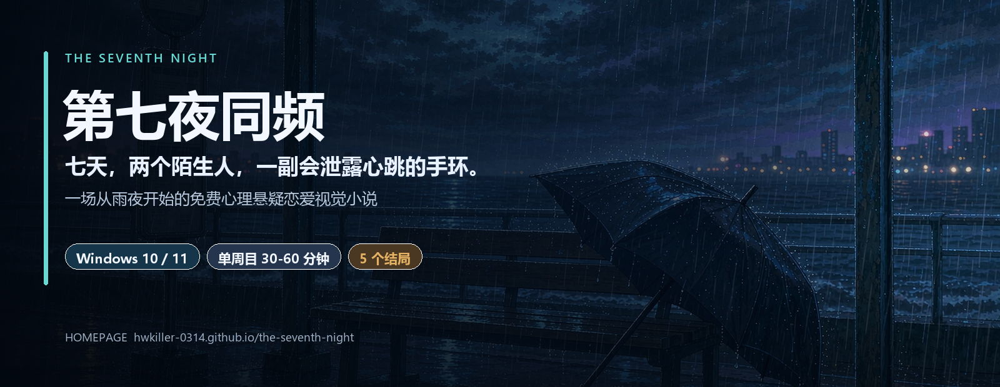
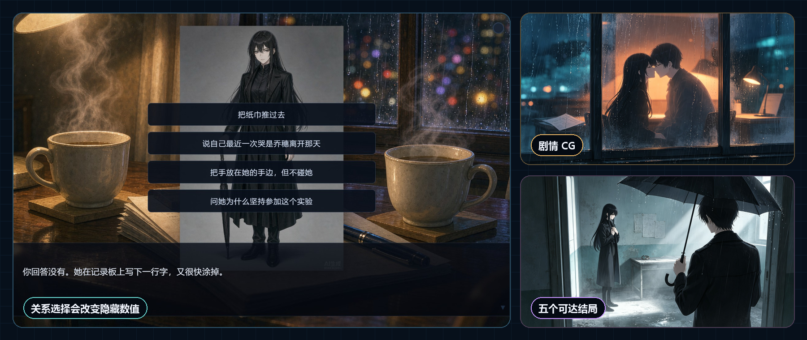
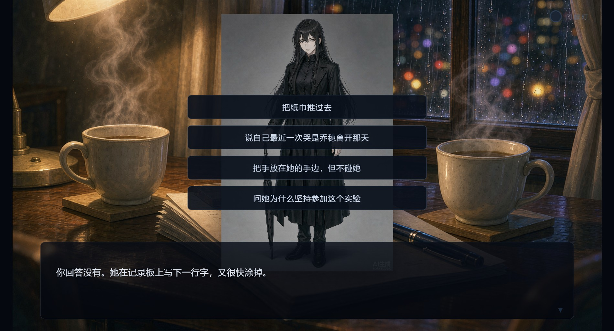
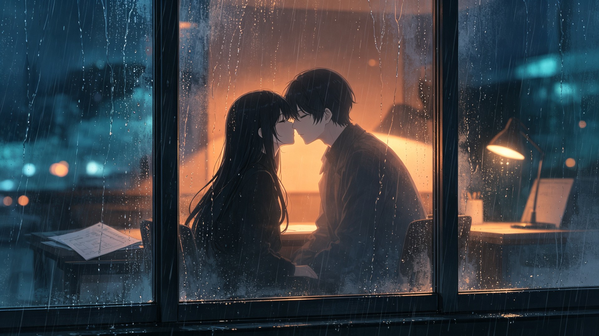
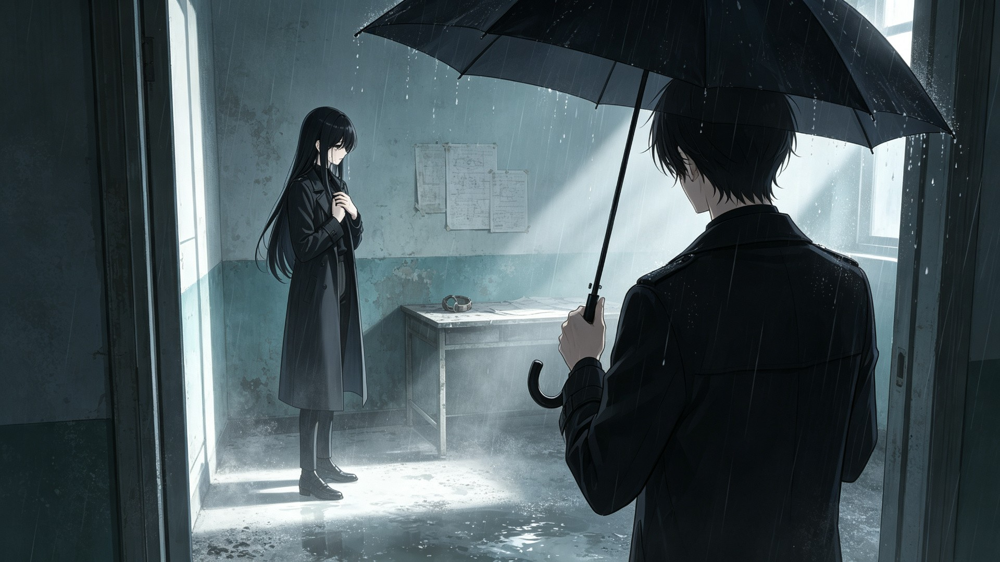
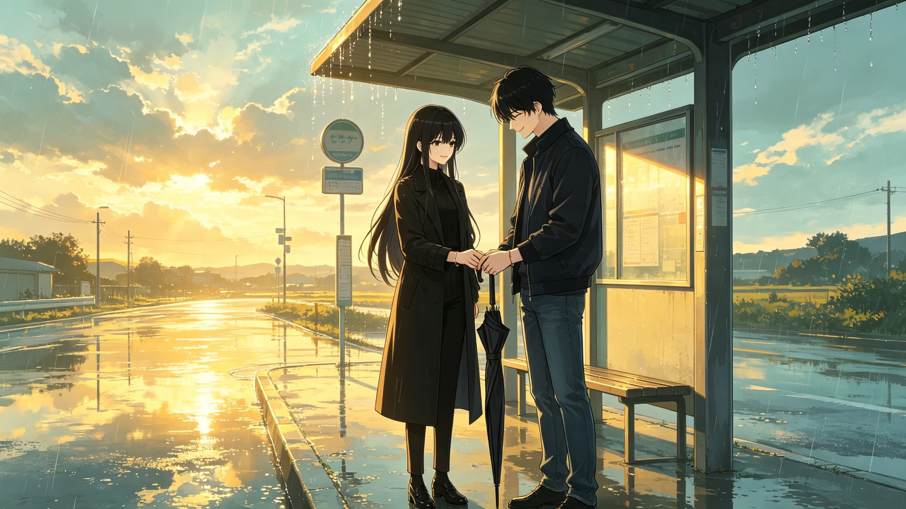

# 第七夜同频

**七天，两个陌生人，一副会泄露心跳的手环。**

一场从雨夜开始的免费心理悬疑恋爱视觉小说。
单周目约 30 至 60 分钟，包含五个可达结局。

> 你在一场“亲密关系重建计划”中，与陌生人 S-07 共同生活七天。两个人的心率曲线越来越接近，但她参加实验的目的并不简单，而三年前那把黑伞，似乎也把你们引向了同一个雨夜。

## 为什么值得花 40 分钟

- **选择不是装饰。** 信任、同频、真相、清醒四个隐藏数值会随着每次回应变化，并共同把你带向不同结局。
- **关系推进有可视化反馈。** 手环、心率和同频灯让“走近一个人”这件事不再只是一行好感度数字。
- **完整的小体量作品。** 剧本、选择、立绘差分、剧情 CG、雨夜演出、BGM、音效与五个结局都已经打包完成。
- **不设付费门槛。** Windows 安装包免费下载，不需要购买激活码。

## 先看游戏画面

<strong>查看完整截图</strong>

### 关系选择

### 雨窗将吻

### 答案之后

### 雨停了就回家

## 游戏信息

| 项目 | 内容 |
|---|---|
| 类型 | 心理悬疑 / 校园恋爱 / 视觉小说 |
| 视角 | 第二人称 |
| 主线 | 单女主、单线多结局 |
| 结局 | 5 个 |
| 时长 | 单周目约 30 至 60 分钟 |
| 平台 | Windows 10 / Windows 11 64 位 |
| 价格 | 免费发布 |
| 内容说明 | 所有角色均为成年人，不包含裸露画面 |

## 下载与开始

1. 前往 [Releases](https://github.com/hwkiller-0314/the-seventh-night/releases/latest)，下载 `The-Seventh-Night-v1.3.0-Windows-Setup.exe`。
2. 运行安装程序并打开游戏。
3. 首次运行如遇 Windows SmartScreen，选择“更多信息”，再点击“仍要运行”。

当前版本：`v1.3.0`

<strong>系统要求与操作方式</strong>

### 系统要求

- Windows 10 / Windows 11
- 64 位处理器
- 4 GB 以上内存
- 约 1 GB 可用磁盘空间
- 建议使用 1280×720 或更高分辨率

### 操作

- 鼠标左键：推进剧情 / 选择选项
- `Space` / `Enter`：推进剧情
- `A`：自动播放
- `Esc`：打开暂停菜单

## 常见问题

<strong>这是恐怖游戏吗？</strong>

不是。它更偏向心理悬疑和关系描写，主要通过信息差、回忆与选择制造压力。

<strong>需要玩很多周目吗？</strong>

一周目可以完整通关，约 30 至 60 分钟。想收集其他结局时，可以回到关键选择继续探索。

<strong>为什么 Windows 会提示未知发布者？</strong>

这是个人开发者未购买代码签名证书时常见的提示。安装包可以直接运行，校验文件同时放在 [Releases](https://github.com/hwkiller-0314/the-seventh-night/releases) 中。

## 反馈与交流

遇到安装、启动、黑屏、卡顿或剧情无法继续等问题，请通过 [Issues](https://github.com/hwkiller-0314/the-seventh-night/issues/new/choose) 提交。附上 Windows 版本、复现步骤和截图会更容易定位问题。

如果你已经通关，也欢迎留下你抵达的结局和最有印象的一幕。

## 支持这个项目

这是一个由个人完成并公开发布的免费作品。你可以通过以下方式帮助它被更多人看到：

- 点一个 [Star](https://github.com/hwkiller-0314/the-seventh-night/stargazers)，让仓库更容易出现在 GitHub 搜索与推荐中。
- 把游戏分享给喜欢视觉小说或心理悬疑故事的朋友。
- 在 Issues 中留下真实反馈，帮助后续版本继续打磨。

## 更新日志

查看 [CHANGELOG.md](CHANGELOG.md)。

## 版权与素材

游戏内文本、美术、音频与视频素材版权归作者所有，未经许可请勿用于商业再发行、二次售卖或冒充原作者发布。仓库中的安装包、说明文档和展示素材仅供体验、传播与评测使用。

如果你发现素材存在版权或来源问题，请通过 Issues 联系作者处理。

---

**同频灯亮起之前，不要相信雨会停。**

